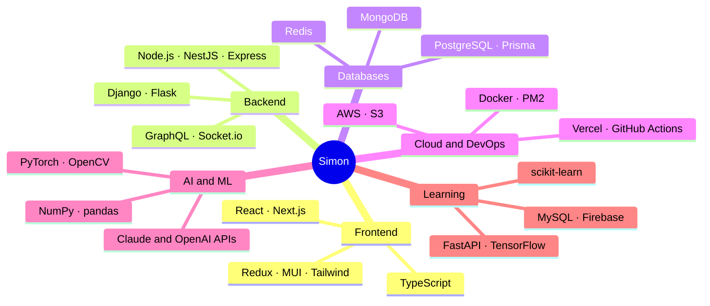

<!-- Intro -->


<div align="center">
<a href="https://git.io/typing-svg"></a>
</div>


<br>

#### 🧑‍💻 Seoul-based full-stack developer
#### 🎓 Senior CSE student at Sejong University
#### 🛠️ Building web apps end to end: API, database, frontend and deploy
#### 🤖 Exploring AI lately: LLMs and computer vision
#### 🌱 Into clean code, good UX and shipping real products

<br clear="right">

## Languages and Tools

<sub>Hover over an icon to see its name.</sub>

**🎨 Frontend**<br>
&nbsp;&nbsp;&nbsp;&nbsp;&nbsp;&nbsp;&nbsp;&nbsp;&nbsp;&nbsp;&nbsp;&nbsp;&nbsp;&nbsp;&nbsp;&nbsp;&nbsp;&nbsp;&nbsp;&nbsp;&nbsp;&nbsp;&nbsp;&nbsp;&nbsp;&nbsp;

**⚙️ Backend**<br>
&nbsp;&nbsp;&nbsp;&nbsp;&nbsp;&nbsp;&nbsp;&nbsp;&nbsp;&nbsp;&nbsp;&nbsp;&nbsp;&nbsp;&nbsp;&nbsp;

**🗄️ Databases**<br>
&nbsp;&nbsp;&nbsp;&nbsp;&nbsp;&nbsp;

**☁️ Cloud & DevOps**<br>
&nbsp;&nbsp;&nbsp;&nbsp;&nbsp;&nbsp;&nbsp;&nbsp;&nbsp;&nbsp;&nbsp;&nbsp;

**🧰 Tools & AI Assistants**<br>
&nbsp;&nbsp;&nbsp;&nbsp;&nbsp;&nbsp;&nbsp;&nbsp;&nbsp;&nbsp;&nbsp;&nbsp;&nbsp;&nbsp;&nbsp;&nbsp;&nbsp;&nbsp;&nbsp;&nbsp;&nbsp;&nbsp;&nbsp;&nbsp;

**🧠 AI & Machine Learning**<br>
&nbsp;&nbsp;&nbsp;&nbsp;&nbsp;&nbsp;&nbsp;&nbsp;&nbsp;&nbsp;&nbsp;&nbsp;

**🌱 Currently Learning**<br>
&nbsp;&nbsp;&nbsp;&nbsp;&nbsp;&nbsp;&nbsp;&nbsp;


<!-- About -->
<div align="center">

## 🎯 About Me

</div>

<table align="center">
<tr>
<td width="50%" valign="top">



</td>
<td width="50%" valign="top">

```diff
@@  Right Now  @@
+ Senior CSE @ Sejong University
+ Building Campusly (school LMS)
+ Capstone: Physical AI scene understanding

@@  Shipped  @@
+ School LMS: campusly.uz (Vercel + AWS)
+ K-beauty e-commerce store: live
+ LLM language verifier (team of 7)
+ Food image classifier: 94% accuracy

! Clean code · Good UX · Shipped
# Open to internships & collaboration 🤝
```

</td>
</tr>
</table>


<!-- Projects -->
<div align="center">

## 🚀 Featured Projects

<table>
  <tr>
    <td align="center" width="25%" valign="top">
      <h3>🏫 Campusly</h3>
      <p><b>School LMS</b></p>
      <sub>Students · teachers · parents<br>Homework, quizzes, grades, video<br>NestJS · GraphQL · Prisma · Next.js</sub>
      <br><br>
      <a href="https://campusly.uz"></a>
    </td>
    <td align="center" width="25%" valign="top">
      <h3>✨ K-Glow</h3>
      <p><b>K-Beauty E-Commerce</b></p>
      <sub>Shop · cart · orders · reviews<br>Customer SPA + SSR admin panel<br>React · Redux · Express · MongoDB</sub>
      <br><br>
      <a href="https://k-glow-react.vercel.app"></a>
    </td>
    <td align="center" width="25%" valign="top">
      <h3>🤖 Physical AI</h3>
      <p><b>Capstone · Team of 7</b></p>
      <sub>RGB-D camera → 3D scene graph<br>I built the LLM language verifier<br>Python · Ollama · Qwen · pytest</sub>
    </td>
    <td align="center" width="25%" valign="top">
      <h3>🍔 Menu Detector</h3>
      <p><b>Computer Vision</b></p>
      <sub>Fine-tuned MobileNetV2<br>Multi-food dataset · 94% accuracy<br>PyTorch · OpenCV · Colab</sub>
    </td>
  </tr>
</table>

</div>


<!-- Activity -->
<div align="center">

## 📊 GitHub Activity


</div>


<!-- Contact -->
## Feel free to drop me a line 📬

<a href="https://www.linkedin.com/in/sanjar-kurbonaliyev-9bbb77309"></a>
<a href="mailto:mksanjar04@gmail.com"></a>
<a href="https://github.com/sanjardev23"></a>

